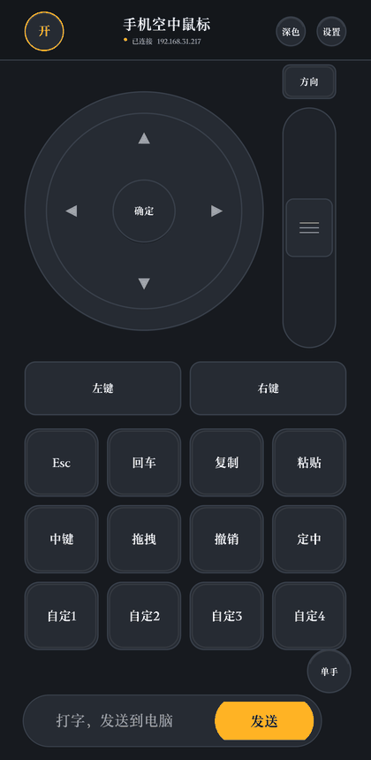
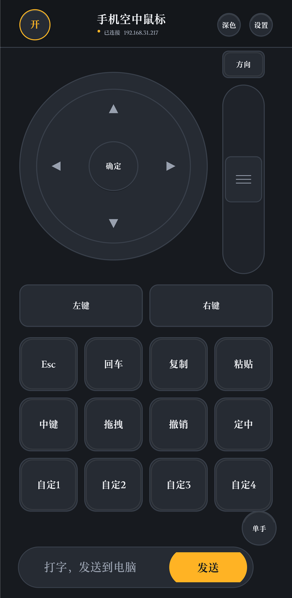
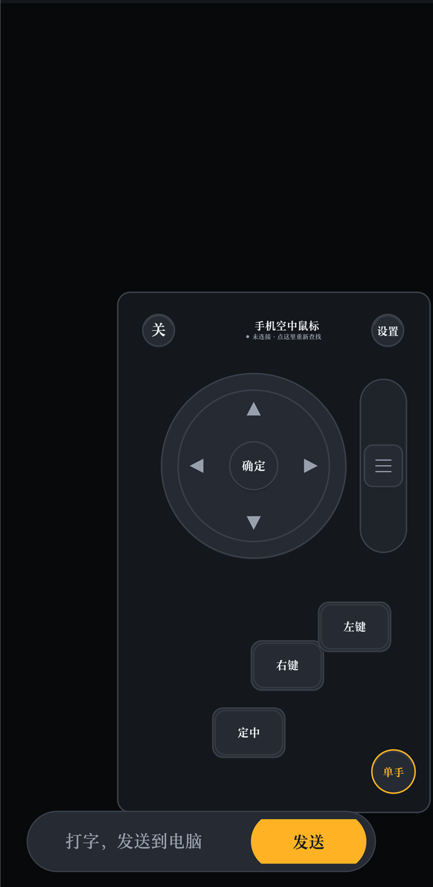
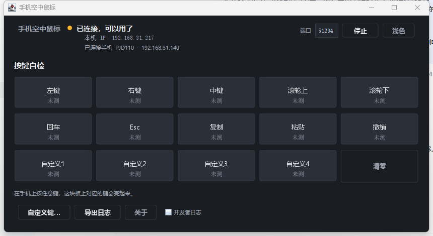

English | [中文](README.md)

# PhoneMouse

Turn your phone into an air mouse for your PC: tilt the phone to move the cursor, use the on-screen
keypad for clicks and keys, and type into your computer from the phone.

Everything goes over **UDP on your local network**. No server, no account, no telemetry.

- **Phone**: native Android (no AndroidX, no Compose — plain Activities plus a custom Canvas view)
- **PC**: Java + Swing, packaged as a portable Windows app with a trimmed JRE

Built for the case where you're lying in bed, sitting on a couch, or doing a demo and
the laptop is out of reach.



<sub>Theme switch · direction/media dial · one-handed mode</sub>

| Phone | One-handed | PC |
|---|---|---|
|  |  |  |

## ⚠️ Security model — read this first

**The protocol has no authentication.** Any device on the same LAN that knows the PC's IP and
port (UDP 51234 by default) can send commands to a running receiver: move the cursor, press keys,
inject text.

So:

- Use it **only on a network you trust** (your home, your phone's hotspot)
- Do not leave the receiver running on public or corporate Wi-Fi
- When Windows Firewall asks on first run, click "Allow" **only** for a network you trust

A shared token is on the roadmap. The current version has none.

## Features

**Phone**

- Gyroscope cursor control with drift compensation: incremental integration, 200-frame median
  bias estimate, P90–P10 stationarity test, 3-point median filter. Stationary for 20 seconds
  produces zero movement packets — there is a reproducible test for this.
- Dial with two modes: D-pad / media keys (volume, track skip, play-pause)
- Scroll strip that follows your finger and springs back to center on release
- Key panel: left / right / middle click, Esc, Enter, Copy, Paste, Undo, drag-lock, re-center
  ("clutch"), and 4 user-defined keys
- Text input in a full-screen editor; Chinese text is injected as Unicode, so it bypasses IMEs
- **One-handed mode**: the whole panel shrinks into the bottom-right corner, with keys laid out
  along an arc that follows your thumb
- Dark / light theme, one tap

**PC**

- Dark instrument-panel UI with a live key-test board
- Shows its own LAN IP and the connected phone, so you always know what to type
- User-defined keys written as plain strings: `key CTRL+C`, `whl -1`, `clk L`
- One-click log export
- Window deliberately never steals focus (otherwise Ctrl+V would paste into itself)

## Quick start

**PC**

```powershell
cd pc
build.bat            # compiles the Java sources and packages the jar
```

Then run `启动接收端.bat` (`start-receiver.bat`). To build a portable app image:

```powershell
jlink --add-modules java.base,java.desktop,java.logging,java.prefs --output _rt `
      --strip-debug --no-man-pages --no-header-files --compress=2

jpackage --type app-image --input _pkg\input --main-jar PhoneMouseReceiver.jar `
         --main-class phonemouse.PcReceiver --name PhoneMouse --dest _dist `
         --runtime-image _rt
```

The four helper executables (text injection, key injection, volume, media keys) are compiled from
the `.cs` sources in `pc/` with the C# compiler shipped with Windows. They are **not** committed —
see `docs/BUILD.md` for the exact `csc` commands.

**Phone**

```powershell
# first copy android/keystore.properties.example to android/keystore.properties and fill it in
$env:JAVA_HOME='<your JDK 17>'
$env:ANDROID_HOME='<your Android SDK>'
gradle -p android assembleRelease
```

> The repository contains **no** keystore. Generate your own:
> `keytool -genkeypair -keystore _keystore/phonemouse.jks -alias phonemouse -keyalg RSA -keysize 2048 -validity 10000`

## How it works

```
Phone ── UDP 51234 ──▶ PC
  mv <dx> <dy>          accumulate → apply every 8 ms (single Robot.mouseMove)
  btn <id> down|up      table-driven mapping: id → action
  txt <base64>          Unicode injection via TypeText.exe
  ping / pong           discovery, replies on the channel the request came from
```

Cursor movement is batched on the PC side: at 60 Hz, applying every packet individually
queues up, and the cursor keeps travelling after you stop. Accumulating and flushing every 8 ms
with a ±200 px clamp fixes it.

## Project layout

```
android/          phone app (Gradle)
  app/src/main/java/com/mzl/phonemouse/
    MainActivity.java     wiring + the locked sensor core
    BoardView.java        full-screen custom canvas: drawing, hit-testing, gestures
    BoardLayout.java      coordinate table (including the one-handed coordinate space)
    Theme.java            design tokens
pc/               desktop app
  src/phonemouse/
    proto/    one-line protocol parsing
    net/      UDP and Bluetooth serial
    keymap/   key id → action, the single source of truth
    input/    Robot and the four helper executables
    ui/       custom-painted Swing components
  test/       golden behaviour regression
docs/             protocol, sensor notes, layout, design system, build
```

## Regression test

After touching the key mapping:

```powershell
pwsh -File pc/test/compare-golden.ps1
```

It compares the real behaviour of 24 key ids plus 4 custom-key routes against
`docs/GOLDEN_BUTTONS.tsv`. It must print `GOLDEN OK`.

## Known limitations

- No authentication on the protocol (see above)
- The Bluetooth serial path is a reserved hook and is disabled by default
- Cursor clamping uses the union of all monitors
- "Clutch" (re-center) is a latching toggle and is released when the app resumes

## Docs

- [docs/HANDOVER.md](docs/HANDOVER.md) — architecture, protocol, sensor history
- [docs/PROTOCOL.md](docs/PROTOCOL.md) — protocol truth table, derived from code
- [docs/SENSOR_LOCK.md](docs/SENSOR_LOCK.md) — the locked sensor algorithm
- [docs/DESIGN.md](docs/DESIGN.md) — why the UI looks the way it does
- [docs/REWRITE_NOTES.md](docs/REWRITE_NOTES.md) — bugs found and fixed during the rewrite
- [docs/BUILD.md](docs/BUILD.md) — build and packaging

## Author

**mzl** — [@mzl12345](https://github.com/mzl12345)

## License

[MIT](LICENSE)
