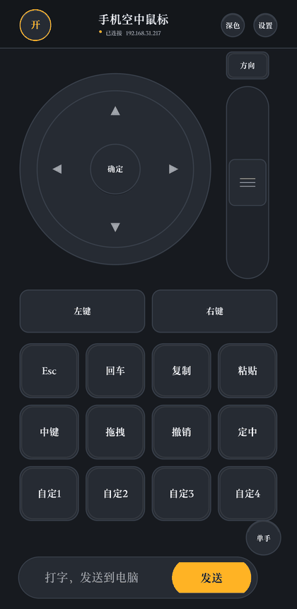
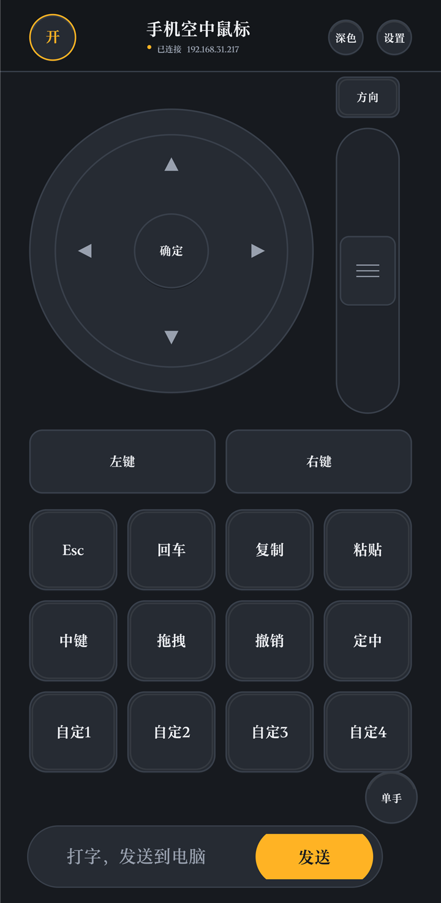
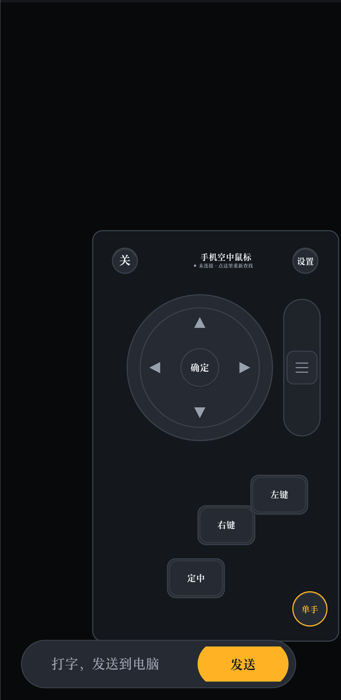
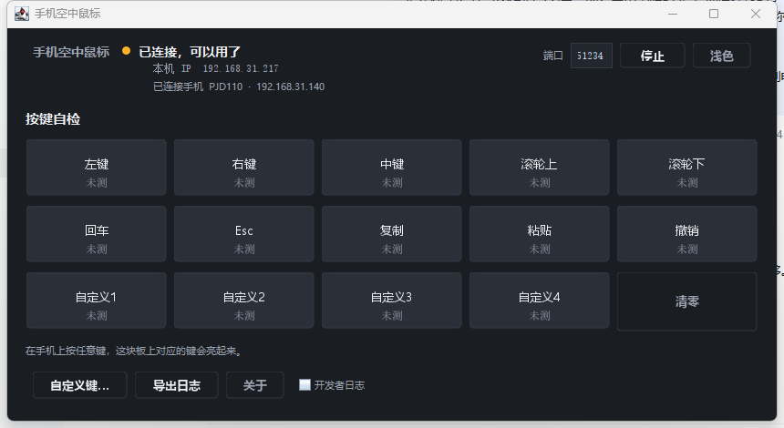

# 手机空中鼠标 PhoneMouse

用手机当电脑的空中鼠标：握着手机转动就能移动光标，配一块按键面板和文字输入。
走**局域网 UDP**，不经过任何服务器，不收集任何数据。

- **手机端**：原生 Android（无 AndroidX，纯 Activity + Canvas 自绘）
- **电脑端**：Java + Swing，可打包成免安装 exe（自带精简 JRE）
- 真实用途：躺床上 / 连电视 / 做演示时，手机当空中鼠标



<sub>深色/浅色切换 · 方向/媒体双模式 · 单手模式</sub>

| 手机端 | 单手模式 | 电脑端 |
|---|---|---|
|  |  |  |

## ⚠️ 安全模型（先看这个）

**协议没有鉴权。** 同一局域网内任何设备只要知道电脑的 IP 和端口（默认 UDP 51234），
就能给运行中的接收端发指令，包括鼠标移动、按键、文字输入。

因此：

- **只在你能信任的局域网里用**（自己家、手机热点）
- 不要在公司、咖啡厅、酒店的公用 Wi-Fi 上开着接收端
- 电脑端第一次运行时 Windows 会弹防火墙提示，**只在你信任的网络里点「允许」**

加共享 token 的鉴权在 roadmap 里，但当前版本**没有**。

## 它有什么

**手机端**

- 陀螺仪空中鼠标：增量式 + 200 帧中位数零偏估计 + 3 点中值滤波，
  静止 20 秒不动（有可复现的静止测试）
- 圆盘双模式：方向键 / 媒体键（音量、切歌、播放暂停）
- 滚动条跟手、松手回弹、每 46px 一格
- 按键面板：左/右/中键、Esc、回车、复制、粘贴、撤销、拖拽、定中、4 个自定义键
- 文字输入：全屏大输入框，中文直接打到电脑上（Unicode 注入，不撞输入法）
- **单手模式**：整套面板缩小贴到右下角，按键沿拇指划弧排布
- 深色 / 浅色一键切换

**电脑端**

- 深色仪器面板风格，按键自检板（按了哪个键、按过几次一目了然）
- 显示本机 IP 和已连接手机，方便小白顺手填
- 自定义键：`key CTRL+C` / `whl -1` / `clk L` 这类简单写法
- 一键导出日志到桌面
- 窗口故意不抢焦点（否则 Ctrl+V 会粘到自己窗口里）

## 快速开始

**电脑端**

```powershell
cd pc
build.bat            # 编译 + 打包 jar
```

然后双击 `启动接收端.bat`。想做免安装包：

```powershell
jlink --add-modules java.base,java.desktop,java.logging,java.prefs --output _rt `
      --strip-debug --no-man-pages --no-header-files --compress=2

jpackage --type app-image --input _pkg\input --main-jar PhoneMouseReceiver.jar `
         --main-class phonemouse.PcReceiver --name PhoneMouse --dest _dist `
         --runtime-image _rt
```

**手机端**

```powershell
# 先按 android/keystore.properties.example 建好自己的签名配置
$env:JAVA_HOME='<你的 JDK 17>'
$env:ANDROID_HOME='<你的 Android SDK>'
gradle -p android assembleRelease
```

> 签名：仓库里**不含** keystore。要出能覆盖安装的 release 包，自己生成一个：
> `keytool -genkeypair -keystore _keystore/phonemouse.jks -alias phonemouse -keyalg RSA -keysize 2048 -validity 10000`

## 项目结构

```
android/          手机端（Gradle 工程）
  app/src/main/java/com/mzl/phonemouse/
    MainActivity.java     组装 + 传感器核心（SENSOR-CORE 区间）
    BoardView.java        整屏自绘：绘制 + 命中 + 手势
    BoardLayout.java      坐标表（含单手模式的独立坐标系）
    Theme.java            视觉 token
    SettingsActivity.java 设置页
pc/               电脑端
  src/phonemouse/
    proto/    单行协议解析
    net/      UDP / 蓝牙串口
    keymap/   按键编号 → 动作（表驱动，唯一真值表）
    input/    Robot 与 4 个辅助 exe
    ui/       自绘组件
  test/       黄金行为表回归脚本
docs/             文档（见下）
```

## 文档

| 文件 | 内容 |
|---|---|
| [docs/HANDOVER.md](docs/HANDOVER.md) | 完整交接：架构、协议、传感器、踩过的坑 |
| [docs/PROTOCOL.md](docs/PROTOCOL.md) | 通信协议真值表（从代码反推，非手写推测） |
| [docs/SENSOR_LOCK.md](docs/SENSOR_LOCK.md) | 传感器算法锁定说明 + 指纹 |
| [docs/LAYOUT.md](docs/LAYOUT.md) | 界面坐标表（1440×3168 基准） |
| [docs/DESIGN.md](docs/DESIGN.md) | 设计系统：为什么长这样 |
| [docs/REWRITE_NOTES.md](docs/REWRITE_NOTES.md) | 重写过程中发现/修掉的问题 |
| [docs/BUILD.md](docs/BUILD.md) | 构建与打包 |

## 回归测试

改按键映射之后必须跑：

```powershell
pwsh -File pc/test/compare-golden.ps1
```

它把 24 个按键编号 + 4 条自定义键路由的实际行为，和 `docs/GOLDEN_BUTTONS.tsv`
逐行比对。输出 `GOLDEN OK` 才算没改坏。

## 已知限制

- 协议无鉴权（见上）
- 蓝牙 SPP 链路是预留接口，当前默认不启用，回复走「从哪条链路来就从哪条链路回」
- 光标按所有屏幕并集钳制，多显示器下不会被挡住（v2.1 起）
- 「定中」是锁定式开关，切到别的 App 再回来会自动解除

## 作者

**mzl** — [@mzl12345](https://github.com/mzl12345)

## License

[MIT](LICENSE)
